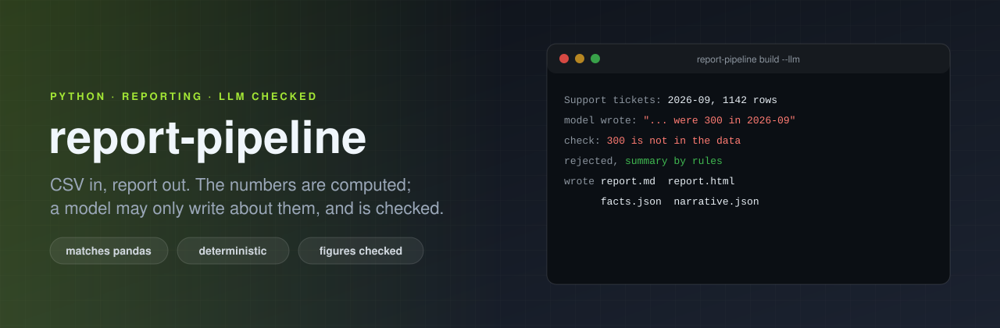
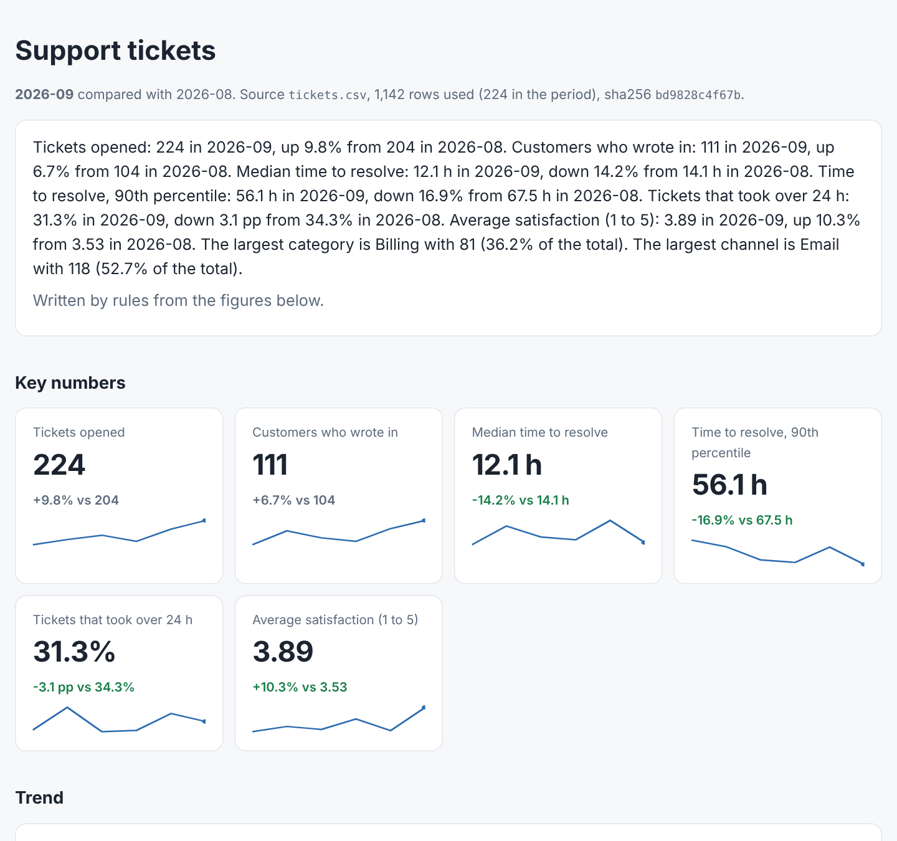

<p align="center">
  
</p>

# report-pipeline

[](https://github.com/ErenOzgu/report-pipeline/actions/workflows/ci.yml)


[](LICENSE)

Reports written with a language model fail in one specific way: **the numbers**. A model asked to "summarise this table" will round, mix up two columns, or produce a plausible figure that is nowhere in the data, and the text reads exactly as confident as a correct one.

This pipeline splits the job so that cannot happen unnoticed.

1. **The numbers are computed**, from the CSV, with plain arithmetic, from a short spec. Every figure is written once into a `facts.json`.
2. **The report is rendered from the facts**: a markdown and a self-contained HTML file, with the change from the last period, the trend, breakdowns, notes about the data, and how each number was computed.
3. **A model may write the summary paragraph, and only that**, from the facts alone. Its text is then **checked**: every figure in it has to be in the facts, and "up" or "down" next to a change has to match the sign. A text that fails is **replaced** by the rules' own summary, and the report says so.

Without `--llm` there is no model at all. The rules write the summary, and it is still the same report.

<p align="center"></p>

```sh
pip install git+https://github.com/ErenOzgu/report-pipeline

report-pipeline build examples/support-tickets/spec.toml --out out
#   Support tickets: 2026-09, 1142 rows used, 4 data notes
#   summary by rules
#   wrote out/report.md, report.html, facts.json, narrative.json

ANTHROPIC_API_KEY=... report-pipeline build spec.toml --llm      # a model writes the summary, checked
report-pipeline check summary.txt out/facts.json                 # check any text against the facts
report-pipeline validate spec.toml                               # spec and CSV header only
```

The report in the picture is `examples/support-tickets/report/` in this repo, built from a generated, entirely synthetic CSV of 1,147 support tickets (`make_data.py`, fixed seed).

## The spec

```toml
title = "Support tickets"
period_column = "opened"          # which date column defines the periods
period = "month"                  # day | week (ISO) | month
trend_periods = 6

[source]
path = "tickets.csv"
key = "ticket_id"                 # optional: repeated keys are dropped, and counted

[columns]                         # text | category | number | date
ticket_id = "text"
opened = "date"
category = "category"
resolution_hours = "number"

[[metric]]
id = "median_resolution"
label = "Median time to resolve"
agg = "median"                    # count sum mean median min max p90 p95 distinct rate
column = "resolution_hours"
unit = "h"
decimals = 1
better = "down"                   # colours the change in the HTML

[[metric]]
id = "slow"
label = "Tickets that took over 24 h"
agg = "rate"                      # share of the period's rows that match `where`
unit = "%"
where = [{ column = "resolution_hours", op = ">", value = 24 }]

[[breakdown]]
id = "by_category"
by = "category"
metrics = ["median_resolution", "slow"]
top = 6                           # the rest becomes "Other (n more)"
```

A spec with a typo fails with a message that names it (`metric 'total': unknown agg 'summ'`), not with a stack trace.

## What the pipeline guarantees

- **The numbers do not come from a model.** They are computed from the rows, and an independent implementation agrees (see below).
- **Same input, same bytes.** There are no timestamps and no random ordering; CI rebuilds the example and diffs it against the committed report.
- **Problems with the data are written into the report**, not hidden: rows with no usable date, repeated keys, values that are not numbers (treated as empty), empty cells, and a period that is incomplete (`2026-09 is incomplete: the data ends on 2026-09-17`; comparing it with a full month understates it).
- **The source is identified**: the report carries the file name and the SHA-256 of the exact bytes it was built from.
- **Rows never reach a model.** What is sent is the list of aggregates in `facts.json` (and the names of the groups in a breakdown, see below). A test searches the whole request body for ticket ids, customer names and agent names from the data.

## The checked summary

With `--llm` the model gets the facts as lines of text and instructions: use only these facts, copy every number exactly, as digits, compute nothing new, say "up" or "down" as the signs say. Then `check`:

| Check | What fails |
|---|---|
| **Every figure is in the facts** | `190.00` when no figure of the data is 190.00; "about 180" for 175.00; `175.5` for `175.00`. The same value written differently (`175` for `175.00`, `1,500` for `1500`) is the same figure. Numbers in period labels and data notes are allowed. |
| **Direction matches the sign** | "orders **fell** 25.0%" when orders rose 25.0%. Judged per figure, by the nearest direction word. |

A text that fails is not repaired and not shown as the summary. The rules' summary takes its place, the report says why (`A summary written by claude-sonnet-5-5 was rejected (figures that are not in the data: 300)`), and `narrative.json` keeps the rejected text. The rules' own summary passes the same check (a property test over several datasets), so the paragraph in a report is always one that has been checked, whoever wrote it.

You can use the checker alone, on text from anywhere: `report-pipeline check text.txt facts.json` exits 1 and lists what failed.

## How it is tested

- **An independent implementation.** The tests recompute every metric of every month of the example, and of eight random datasets with holes in them, with **pandas**, and require equal results: counts, distinct counts, sums, means, medians, 90th percentiles (linear interpolation, as pandas and numpy do), rates, and the group tables. pandas is a test dependency only; the tool uses the standard library.
- **Periods**: ISO weeks across a 53-week year, leap days, year ends, a gap month (zero orders, but *no* revenue figure and no percent change from zero), and every day of 800 days lands in exactly the period whose start and end contain it.
- **The checker**: the rules' summary always passes; made-up figures, rounded figures and reversed directions fail; digits glued to words (`v2.1`) are not figures.
- **A fake Messages API server**: a good text is used, a text with one wrong figure is rejected and replaced, a wrong direction is rejected, an API error falls back without raising, and the request contains the facts and no row.
- **HTML**: values from the data are escaped (`<script>` as a category name), the page has no scripts, links or external resources, and carries a dark-mode stylesheet and a viewport tag (layout itself is not tested).
- **CI**: the example CSV is regenerated and diffed; the committed report is rebuilt and diffed; and a text with a made-up figure must make `check` fail, or the job fails.

## What it cannot do

- **A figure can be right and attached to the wrong thing.** The check proves that a number *exists* in the facts, not that the sentence says the right thing about it. If a model swaps two metrics that both appear in the facts, the check passes. Only the *change* figures are tied to a direction. The prompt gives the model one labelled line per metric to make a swap unlikely, not impossible.
- **Only digits are checked.** "Doubled" or "half" are not figures to the checker. The prompt asks for digits.
- **No causes.** The model is told not to explain why; the checker cannot catch a made-up reason, only made-up numbers.
- **Group names are sent** (the names of the categories in a breakdown, as `Billing` or `Email`). If those are sensitive, leave out the breakdowns or do not use `--llm`.
- **The CSV has to be plain**: UTF-8, ISO dates (`2026-09-30`, with an optional time), numbers like `1234.5` (no thousands separators, no decimal comma). Anything else is counted as unreadable and reported, not guessed.
- **One CSV, one date column.** No joins and no formulas; a metric is one aggregation with optional filters. A rate's denominator is all rows of the period.
- **Not a BI tool.** It makes one fixed report layout, on purpose: the point is the numbers and the check.

## Layout

```
report_pipeline/
  spec.py         the TOML spec and its errors
  data.py         CSV with types; what could not be read
  metrics.py      periods, aggregations, breakdowns, notes
  facts.py        the facts file, and the set of figures a text may use
  narrative.py    rules' summary, model step, the checker
  render.py       markdown and HTML
  cli.py
examples/support-tickets/   generator, spec, CSV, committed report
tests/                      unit tests, the pandas oracle, a fake Messages API
```

## License

MIT, see [LICENSE](LICENSE).
